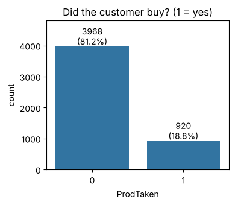
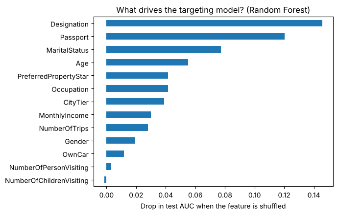
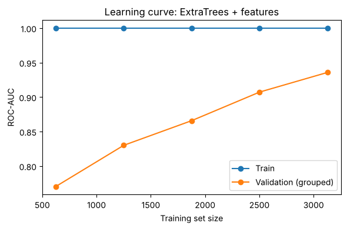
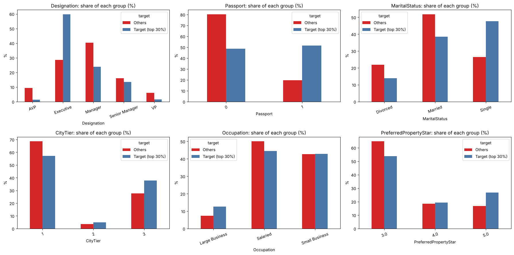

# Wellness Tourism Package: Who Will Buy?

A simple machine learning project that predicts **which customers are likely to buy a new travel package**, so the sales team can call the best customers first.

## The problem

A travel company is launching a **Wellness Tourism Package**. Only about **1 in 5 customers (18.8%)** says yes. Calling everyone wastes time and money.

**Goal:** give every customer a score for how likely they are to buy, using only facts known **before** the call, and turn the scores into priority groups **A, B and C**.

## The data

- 4,888 customers, 18 columns after cleaning
- Facts such as age, income, job level, passport, marital status, city tier and trips per year
- Target: `ProdTaken` (1 = bought, 0 = did not)



Most customers say "no", so a model that always says "no" is already **81% accurate** and finds nobody. That is why we judge the model with **AUC, recall and precision**, not accuracy alone.

## What we did

1. **Checked and cleaned the data**: fixed the spelling mistake "Fe Male", merged "Unmarried" into "Single", grouped 2 Free Lancer rows, and removed a column that repeated another.
2. **Explored**: buyers are younger and far more likely to have a passport.
3. **Built a simple model first** (logistic regression): AUC 0.75, a good starting line.
4. **Tried stronger models** (Random Forest, Gradient Boosting, ExtraTrees) and chose by honest cross-validation.
5. **Fixed a hidden trap**: some customers appear twice with the same profile. We kept them together while testing, so the score is fair.
6. **Added a few "combo clues"**, for example Executive + Passport + Single.
7. **Tested once** on 978 customers the model had never seen.

## What matters most



The top clues are **job level (Designation), passport, marital status and age**.

| Clue | What it means |
|---|---|
| Passport | About **5x** the odds of buying |
| Single | About **2.7x** the odds |
| City Tier 3 | About **3.1x** the odds |
| Executive job level | Much more likely than Manager, VP or AVP |
| More follow-up calls | More likely to buy |

## Final model and results

**Model:** ExtraTrees with the new combo clues.

| Measure | Result |
|---|---|
| Test AUC | **0.957** (95% range 0.943 to 0.970) |
| Honest cross-validated AUC | **about 0.935** |
| Simple starting model | 0.749 |
| Shuffled-answer check | 0.515 (about 0.50, so **no leakage**) |

**Priority groups on the test customers**

| Group | Customers | Bought | Buy rate | Share of all buyers |
|---|---|---|---|---|
| **A** (top 10%) | 101 | 95 | **94.1%** | 51.6% |
| **B** (next 20%) | 165 | 68 | 41.2% | 37.0% |
| **C** (rest) | 712 | 21 | 2.9% | 11.4% |

Calling only groups **A and B** (about 27% of customers) reaches roughly **89% of all buyers**.

## Is it overfitting?



Training score is perfect (1.00), while cross-validation is 0.935 and test is 0.957. That is **mild overfitting**, normal for forests, and the model still works well on new customers. The curve is still rising, so **more data would help**. When we scrambled the answers, the score fell to about 0.50, so the model learned real patterns, not tricks.

## Who should the team call first?



The top 30% of scored customers buy **57%** of the time, against **2.8%** for everyone else. They are:

- **Younger** (average 34.7 vs 38.8 years)
- **Twice as likely to hold a passport** (51% vs 20%)
- More often **Executive level** and **Single**

**Simple rule:** young, single, executive-level customers with a passport are the best leads (the best group buys 74% of the time).

If one sale earns 10 times what a call costs, calling the **top 30%** finds **92% of buyers** with a 58% hit rate and the best profit.

## Project files

| File | Purpose |
|---|---|
| `Wellness_Tourism_Package_Prediction.ipynb` | Full documented notebook with plain-language inference |
| `wellness_features.py` | Builds the combo clues and scores new customers |
| `Travel.csv` | The data (add it before running) |

## How to run

```bash
pip install pandas numpy scikit-learn scipy statsmodels matplotlib seaborn joblib
jupyter notebook Wellness_Tourism_Package_Prediction.ipynb
```

Put `Travel.csv` and `wellness_features.py` in the same folder as the notebook. Results can differ by about 0.01 on another computer or library version.

## Next steps

- Collect more customers (the learning curve is still rising)
- Retrain every few months
- Test the plan with a small pilot call campaign
